# ELEC4 – Python Self-Paced Assignments

**Name:** Paul Vincent M. Pavo  
**Section:** IV-BSIT-B  
**Subject:** ELEC4 – Python Programming

---

## About This Repository

This repository contains my outputs for the ELEC4 Python Self-Paced Assignments. It includes activities and exercises that show my understanding of Python fundamentals, functions, modules, data structures, and exception handling.

Each activity is organized into its own folder, with its source code and screenshots of the program outputs.

## Activities

| Activity | Description | Folder |
|---|---|---|
| P1 – Student Grade Calculator | Calculates the average, highest, and lowest grades and determines the student's passing status. | [p1](set1/p1/) |
| P2 – Custom Module: student_utils | Uses custom modules and Python's built-in datetime module to generate a student grade report. | [p2](set1/p2/) |
| P3 – Student Record Manager | Adds, removes, searches, and displays student records using lists and sets. | [p3](set1/p3/) |
| P4 – Safe Menu Program | Demonstrates exception handling when performing division and reading files. | [p4](set1/p4/) |

---

## Set 1 Activities

### P1 – Student Grade Calculator

This activity demonstrates the use of functions, lists, loops, conditional statements, and global and local variables. The program allows users to enter grades and view the average, highest grade, lowest grade, and passing status.

**Run the program:**

```bash
cd set1/p1
python p1_grade_calculator.py
```

**Screenshots:**

**Grade Calculator Output**

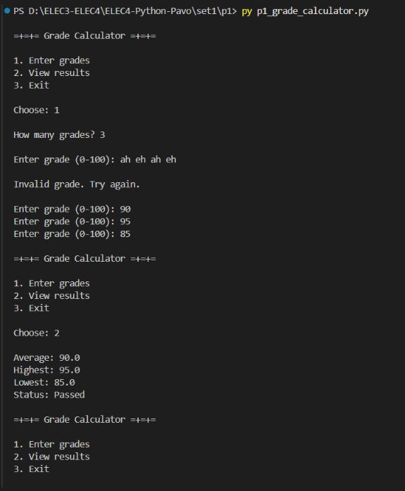

**Exit Output**

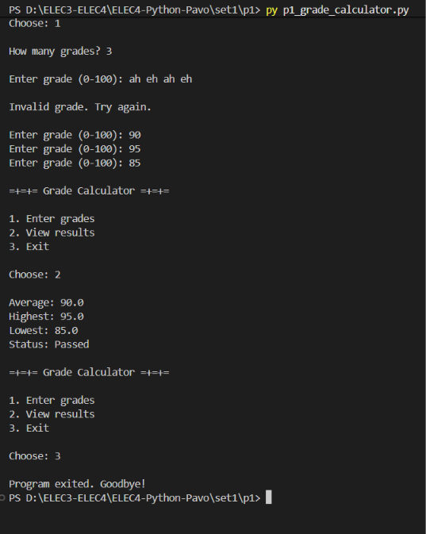

---

### P2 – Custom Module

This activity shows how to create and use custom Python modules. In the program I used a separate `student_utils.py` file containing functions for calculating the average, checking the passing status, and getting the highest and lowest grades. I also used the built-in `datetime` module to display the date and time when the report is generated.

**Run the program:**

```bash
cd set1/p2
python p2_main.py
```

**Screenshots:**

**Student Grade Report**

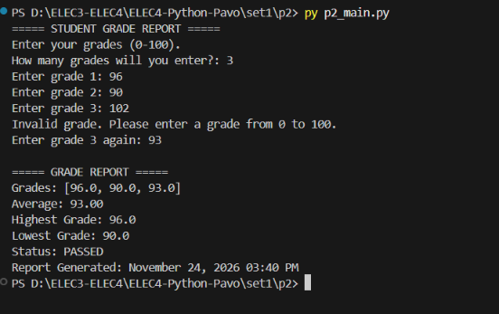

---

### P3 – Record Manager

This activity shows the use of lists and sets to manage student records. The program allows users to add, remove, search, and display student names. It also prevents duplicate entries and supports searching for matching names.

**Run the program:**

```bash
cd set1/p3
python p3_record_manager.py
```

**Screenshots:**

**Add Student**

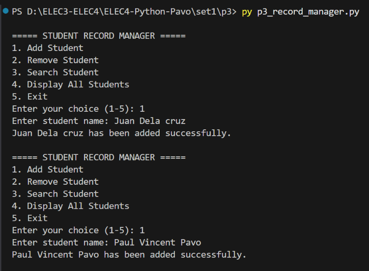

**Duplicate and Invalid Prevention**

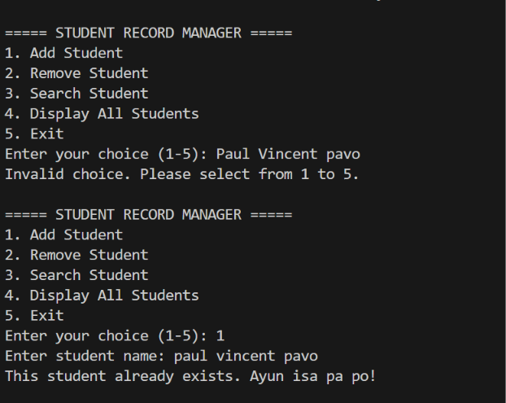

**Remove Student**

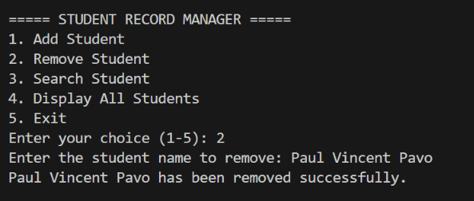

**Search Student**

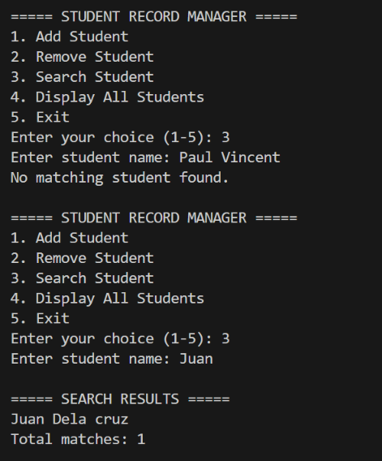

**Display Students**

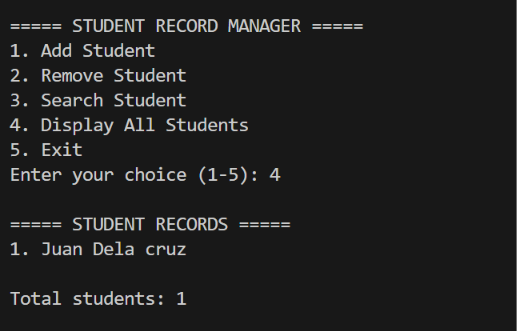

**Exit Program**

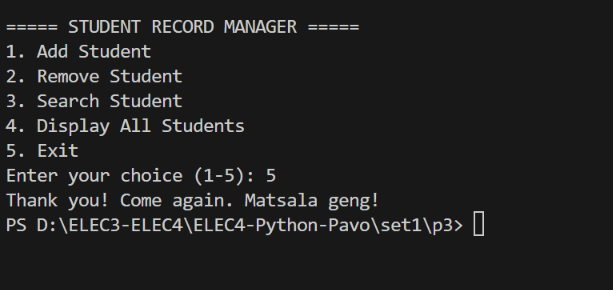

---

### P4 – Safe Menu Program

This activity shows exception handling using `try`, `except`, `else`, and `finally` blocks. The program provides a menu for dividing two numbers and opening and reading a file. It handles invalid numeric inputs, division by zero, missing files, and invalid menu choices.

**Run the program:**

```bash
cd set1/p4
python p4_exceptions.py
```

**Screenshots:**

**Division by Zero**

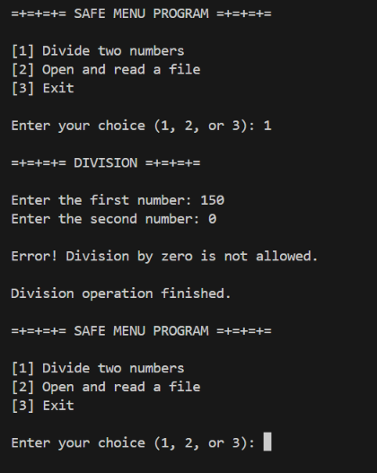

**Invalid Menu Choice**

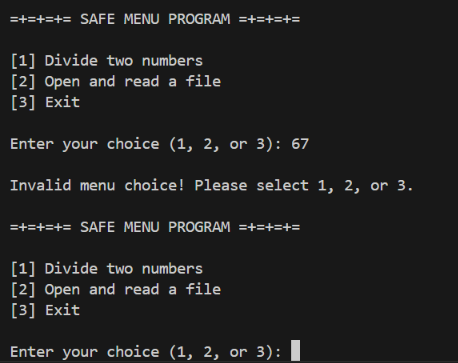

**Invalid Value**

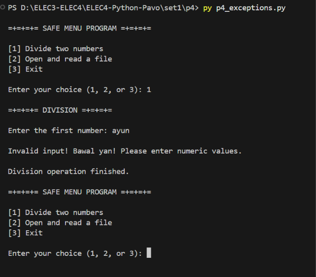

**Missing File**

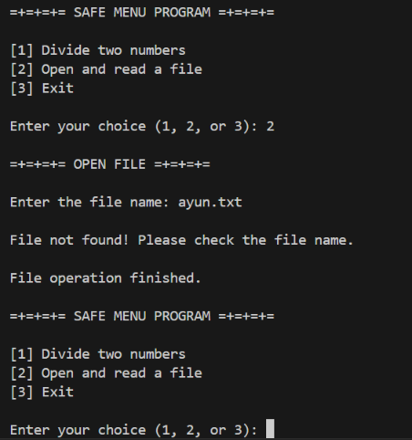

---

## Repository Structure

```text
ELEC4-Python-Pavo/
│
├── .gitignore
├── README.md
│
└── set1/
    │
    ├── p1/
    │   ├── p1_grade_calculator.py
    │   └── screenshots/
    │       ├── P1_Screenshot.png
    │       └── P1_Screenshot_1.png
    │
    ├── p2/
    │   ├── p2_main.py
    │   ├── student_utils.py
    │   └── screenshots/
    │       └── program-output.png
    │
    ├── p3/
    │   ├── p3_record_manager.py
    │   └── screenshots/
    │       ├── add-student.png
    │       ├── display-students.png
    │       ├── duplicate-prevention.png
    │       ├── exit.png
    │       ├── remove-student.png
    │       └── search-student.png
    │
    └── p4/
        ├── p4_exceptions.py
        └── screenshots/
            ├── division-by-zero.png
            ├── invalid-menu-choice.png
            ├── invalid-value.png
            └── missing-file.png
```

---

## Technologies and Concepts Used

- **Python** – Programming language used for the activities.
- **Functions** – Used to organize program operations into reusable blocks of code.
- **Lists** – Used to store and manage collections of data.
- **Sets** – Used to store unique values and prevent duplicate student names.
- **Modules** – Used to organize and reuse Python functions across files.
- **datetime** – Built-in module used to retrieve and format the current date and time.
- **Exception Handling** – Used to handle errors through `try`, `except`, `else`, and `finally` blocks.
- **File Handling** – Used to open and read files.

---

## How to Run

1. Install Python on your computer.
2. Clone or download this repository.
3. Open the project folder in your terminal or code editor.
4. Navigate to the folder of the activity you want to run.
5. Execute the corresponding Python file using the `python` command.

Example:

```bash
cd set1/p1
python p1_grade_calculator.py
```

---

## GitHub Repository

**Repository Link:**  
[ELEC4-Python-Pavo](https://github.com/paulvincent-p/ELEC4-Python-Pavo)

**Branches:**

- `main` – Main branch that contains the completed and merged assignment sets.
- `set-1` – Branch that contains the Set 1 activities.

